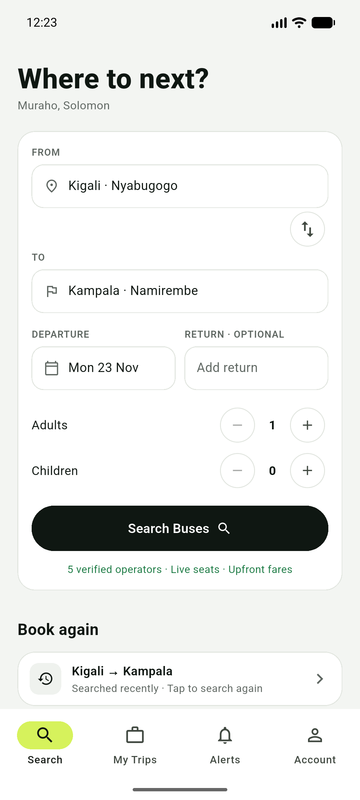
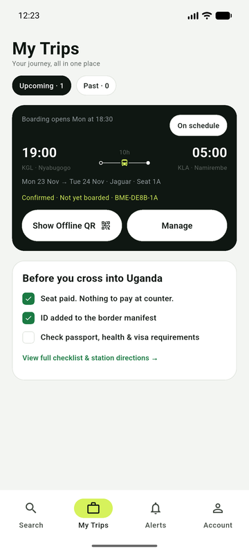
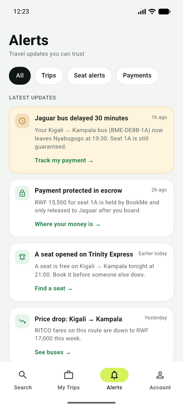
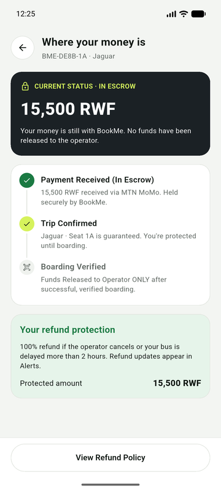
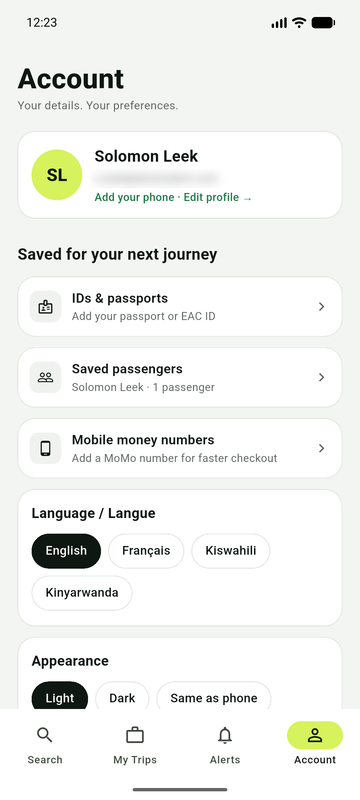
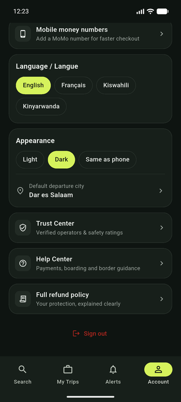
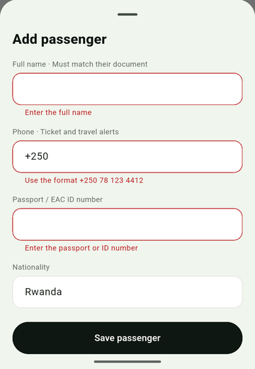
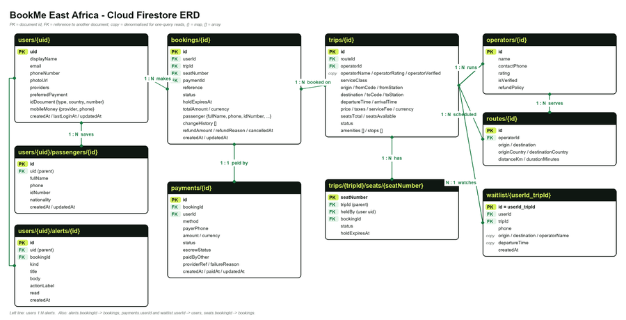
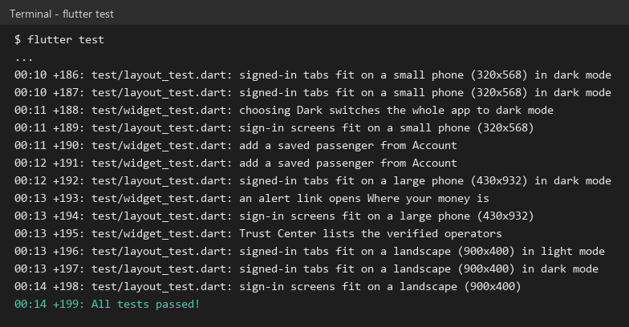
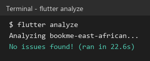

# BookMe East Africa

**Your seat, confirmed before you leave home.**

BookMe East Africa is a Flutter mobile app for booking cross-border bus
trips between Rwanda, Uganda, Kenya, Tanzania, South Sudan and Burundi.
Travellers search verified operators, hold a seat for ten minutes, pay with
mobile money, and board with a QR ticket that also works offline. Their
money stays in escrow until they board, and they get live alerts about
delays, cancellations and seats opening up.

The app is built with **Flutter**, **BLoC** for state management and
**Firebase** (Authentication and Cloud Firestore). It targets **Android and
iOS only**.

| | |
|---|---|
| **Repository** | https://github.com/solomon-211/bookme-east-african |
| **Demo video** | _[add the link to the demo video here]_ |
| **Firebase project** | `bookme-east-africa` |

---

## Contents

1. [Screenshots](#screenshots)
2. [Features](#features)
3. [Tech stack](#tech-stack)
4. [Architecture](#architecture)
5. [Why BLoC](#why-bloc)
6. [Project structure](#project-structure)
7. [Database design (ERD)](#database-design-erd)
8. [Security rules](#security-rules)
9. [Saved preferences](#saved-preferences)
10. [Getting started](#getting-started)
11. [Loading the bus data](#loading-the-bus-data)
12. [Testing and code quality](#testing-and-code-quality)
13. [Git workflow](#git-workflow)
14. [Known limitations](#known-limitations)
15. [Future work](#future-work)
16. [Team](#team)

---

## Screenshots

Captured on a Pixel 7 emulator (Android) with live Firebase data.

| Search | My Trips | Alerts |
|:---:|:---:|:---:|
|  |  |  |
| Search from the saved default city | Upcoming trip, QR ticket and border checklist | Live alerts from Firestore, filtered by type |

| Escrow tracker | Account | Dark mode |
|:---:|:---:|:---:|
|  |  |  |
| The money stays with BookMe until boarding | Profile, saved passengers and preferences | Language, theme and default city, saved on the device |

| Form validation |
|:---:|
|  |
| Adding a passenger with missing or wrong values is rejected before anything reaches Firestore |

---

## Features

### Sign-in (Foundations & Auth)
- Welcome screen with three ways in: phone number with SMS code, email and
  password, or Google.
- Registration, login, logout and password reset by email.
- The user stays signed in between launches; signing out returns to Welcome.
- Every form validates its input before sending it.

### Search
- Search trips by origin, destination and date, starting from the saved
  default departure city.
- Results with a date strip showing the lowest fare per day, plus filters
  (departure time, price range, operator, amenities) to narrow them.
- Trip details: stations, stops, border crossing, amenities, seats left.
- **Waitlist** for full trips: "Notify me" when a seat opens (create and
  delete in Firestore).

### Booking & Payment
- **Ten-minute seat hold** taken in a Firestore transaction, so two people
  can never hold the same seat.
- "Who's travelling?" form, with or without a saved passenger.
- Mock payment (MTN MoMo, M-Pesa, Airtel Money, Visa/Mastercard) with an
  "approve on your phone" step.
- **Someone else is paying:** send a 30-minute payment request by link or
  SMS.

### Tickets & Trips
- **My Trips** with upcoming and past trips, and a border checklist.
- Digital ticket with a **QR code**, saved on the phone so it works
  **offline**.
- Manage a booking: **change date** (same price or cheaper) or **cancel**
  with an automatic refund.
- Remove cancelled or finished trips from history.

### Trust & Account
- **Escrow tracker:** a timeline showing the money is held by BookMe and only
  released to the operator after boarding.
- **Alerts** in real time: delays, cancellations, seats opening, price drops,
  payments protected and refunds. Mark as read, delete, filter by type.
- **Account:** profile update and verification status.
- **Saved passengers** with full create, read, update and delete.
- **Trust Center:** verified operators and their ratings.
- **Refund policy** in plain language.
- **Three saved preferences:** language, light/dark theme and default
  departure city. They survive closing and reopening the app.

### CRUD operations at a glance

| Data | Create | Read | Update | Delete |
|---|:---:|:---:|:---:|:---:|
| User profile (`users`) | ✅ at sign-up | ✅ live | ✅ edit profile | — (admin only) |
| Saved passengers | ✅ | ✅ live | ✅ | ✅ |
| Alerts | ✅ | ✅ live | ✅ mark read | ✅ |
| Bookings | ✅ seat hold | ✅ My Trips | ✅ pay, change date, cancel | ✅ remove from history |
| Payments | ✅ | ✅ escrow tracker | ✅ payment result | — |
| Waitlist | ✅ notify me | ✅ | ✅ | ✅ leave |

---

## Tech stack

| Area | Choice |
|---|---|
| Framework | Flutter 3.50 (Dart 3.12), Material 3 |
| State management | `flutter_bloc` (Bloc and Cubit), `equatable` |
| Backend | Firebase Authentication, Cloud Firestore |
| Navigation | `go_router` for sign-in routes; an `IndexedStack` bottom-tab shell after sign-in |
| Local storage | `shared_preferences` (preferences, offline tickets) |
| Other | `google_sign_in`, `qr_flutter`, `url_launcher` |
| Testing | `flutter_test`, `bloc_test`, `mocktail`, `integration_test` |

---

## Architecture

Each feature follows **clean architecture** with three layers:

```
presentation  ->  Widgets + Bloc/Cubit (UI state only)
domain        ->  Entities + abstract repository interfaces (pure Dart)
data          ->  Firestore / SharedPreferences implementations
```

How a user action flows through the app:

```
Widget  --event-->  Bloc / Cubit  --call-->  Repository  --read/write-->  Firestore
   ^                     |                                                    |
   '------ new state ----'  <------------ result / live snapshot -------------'
```

- **Widgets never call Firebase directly.** A screen sends an event to its
  Bloc or Cubit, which calls a repository and emits a new state that the
  screen rebuilds from.
- Every repository has a **Firestore implementation** and an **in-memory
  implementation**. The app uses Firestore; the tests use the in-memory ones,
  so they run fast and without a network.
- Each feature exposes its repositories through one function, such as
  `trustAccountRepositoryProviders(prefs: prefs)`. `main.dart` provides them
  all with a single `MultiRepositoryProvider`.
- Features don't import each other's screens. They connect through small
  navigation objects (`SearchNavigation`, `TicketsNavigation`), which
  `HomeShell` wires together.
- **Settings load before the first frame,** so the app opens in the saved
  theme and language without flashing.

---

## Why BLoC

- **Separation of concerns.** UI code only draws a state and sends events;
  business rules live in Blocs and Cubits; Firebase code lives in
  repositories. Each part can change without breaking the others.
- **Predictable state.** Every screen state is an immutable `Equatable`
  class, so the UI always matches one known state (loading, loaded, error),
  and nothing changes behind the widget's back.
- **Real-time data fits naturally.** Firestore `snapshots()` streams feed
  straight into Cubits, which emit a new state on every change. That is how
  alerts, saved passengers and My Trips update live.
- **Easy to test.** With `bloc_test` we check that an event produces exactly
  the expected states, using in-memory repositories and no network.
- **Bloc or Cubit, as needed.** Flows with many events (sign-in, search) use
  a full `Bloc`; simpler state (settings, selected tab, alerts) uses a
  `Cubit`.

---

## Project structure

```
lib/
  main.dart             Firebase init, settings, every feature's repositories
  app.dart              MaterialApp.router, light/dark theme, status bar style
  firebase_options.dart Firebase config (Android and iOS)
  core/
    constants/          Supported countries and dial codes
    router/             go_router routes for sign-in and the home shell
    theme/              Colours, light/dark palette, ThemeData
    utils/              Validators and formatters
    widgets/            Shared buttons, fields, logo
  features/
    auth/               AuthBloc, sign-in screens
    home/               Bottom-tab shell (Search, My Trips, Alerts, Account)
    search/             SearchBloc, waitlist, results, trip details, seed data
    booking/            Seat hold, passenger form, payment flow
    tickets/            My Trips, QR ticket, offline cache, change/cancel
    escrow/             Escrow tracker
    alerts/             Real-time alerts
    account/            Profile, saved passengers
    trust/              Trust Center, refund policy
    settings/           Language, theme, default city (SharedPreferences)
test/                   Unit, bloc and widget tests (in-memory repositories)
integration_test/       Tickets flow against the Firebase emulators
tool/                   Seed export and upload scripts
docs/                   Database architecture, security rules, screenshots
firestore.rules         Security rules for every collection
firestore.indexes.json  Composite indexes
```

Each feature folder has the same three layers:

```
features/account/
  domain/        user_profile.dart, saved_passenger.dart, account_repository.dart
  data/          account_repository_impl.dart (Firestore), in_memory_account_repository.dart
  presentation/  account_cubit.dart, account_state.dart, account_screen.dart, ...
```

---

## Database design (ERD)



Cloud Firestore is a document database, so related data is either nested
under its owner (subcollections) or linked by an id field:

| Collection | What it holds | Linked to |
|---|---|---|
| `users/{uid}` | Profile: name, email, phone, preferred payment | Firebase Auth user (same `uid`) |
| `users/{uid}/passengers` | Saved passengers: name, phone, ID number, nationality | Owner by path |
| `users/{uid}/alerts` | Alerts: `kind`, `title`, `body`, `read`, `createdAt` | Owner by path, optional `bookingId` |
| `operators` | Bus companies, ratings, verification, refund policy | — |
| `routes` | An operator's route between two cities | `operatorId` |
| `trips` | Scheduled departures with times, price and seats left | `routeId`, `operatorId` |
| `trips/{id}/seats` | One document per seat: `available`, `held` or `booked` | Trip by path, `heldBy`, `bookingId` |
| `bookings` | Trip, seat, passenger, amount, status, reference | `userId`, `tripId`, `paymentId` |
| `payments` | Payment result and escrow status (`none` → `held`) | `userId`, `bookingId` |
| `waitlist/{userId_tripId}` | "Notify me" entries for full trips | `userId`, `tripId` |

**Relationships:** a user has many passengers, alerts, bookings, payments
and waitlist entries. An operator runs many routes, a route has many trips,
and a trip has many seats. A booking belongs to one user, one trip and one
seat, and has one payment.

**Composite indexes** (in `firestore.indexes.json`):
- `trips`: `origin`, `destination`, `departureTime` (the search query)
- `waitlist`: `userId`, `createdAt` descending (a user's waitlist)
- `seats`: `status`, `holdExpiresAt` (finding expired holds)

More detail: [docs/search/database_architecture.md](docs/search/database_architecture.md).

---

## Security rules

[firestore.rules](firestore.rules) protects every collection:

1. **Signed in only:** nothing can be read without a Firebase Auth session.
2. **Owner only:** users touch only their own documents, by path
   (`users/{uid}/...`) or by a `userId` field.
3. **Reference data is read-only:** operators, routes and trips are seeded
   by an admin, not written by the app.
4. **Money is locked:** prices can't change after booking, a refund can't
   exceed what was paid, and the app can never mark escrow as released or
   refunded.
5. **Shape checks:** writes must use known fields with valid types and
   lengths, e.g. a passenger phone must be `+` followed by 12 digits.
6. **Closed by default:** anything not listed is denied.

| Collection | Read | Write |
|---|---|---|
| `users/{uid}` and its `passengers`, `alerts` | Owner | Owner, with field checks (alerts: only `read` can change) |
| `operators`, `routes`, `trips` | Signed in | Never (admin seed only) |
| `trips/{id}/seats` | Signed in | Take a free seat, release or extend your own hold, confirm your own booking |
| `bookings` | Owner | Owner; price, trip and reference locked |
| `payments` | Owner | Owner; escrow can only go from `none` to `held` |
| `waitlist` | Owner | Owner, id must be `userId_tripId` |

**Two layers of validation.** Forms check input in the app first (for
example `AccountValidators.phone`), so users get instant feedback. The rules
check the same things on the server, so bad data is refused even if someone
bypasses the app.

Full explanation: [docs/report/security_rules_and_limitations.md](docs/report/security_rules_and_limitations.md).

Deploy the rules and indexes with:

```sh
firebase deploy --only firestore:rules,firestore:indexes
```

---

## Saved preferences

Three preferences are stored on the device with `SharedPreferences` and
restored on every launch:

| Preference | Key | Values |
|---|---|---|
| Language | `settings.languageCode` | English, Français, Kiswahili, Kinyarwanda |
| Theme | `settings.themeMode` | Light, Dark, Same as phone |
| Default departure city | `settings.defaultDepartureCity` | Any supported city |

`SettingsCubit` saves each change and emits a new state, so the whole app
rebuilds at once. `main.dart` loads them **before the first frame**, so the
app never flashes the wrong theme. A unit test
(`test/features/settings/settings_test.dart`) proves all three survive an
app restart.

---

## Getting started

### Prerequisites

- Flutter 3.47 or newer (stable channel) and Dart 3.12+
- Android Studio with an Android emulator, or a physical Android phone
  (Xcode for iOS)
- Java 17+ (Android Studio's bundled JDK works)
- Optional: Firebase CLI (`npm install -g firebase-tools`) and FlutterFire
  CLI (`dart pub global activate flutterfire_cli`)

Check your setup with:

```sh
flutter doctor
```

### 1. Clone and install

```sh
git clone https://github.com/solomon-211/bookme-east-african.git
cd bookme-east-african
flutter pub get
```

### 2. Firebase

The repository is already connected to the Firebase project
**`bookme-east-africa`** (`lib/firebase_options.dart`,
`android/app/google-services.json`), so the app builds and runs as it is.

- **Google sign-in on your machine:** add your debug SHA-1 in the Firebase
  console (Project settings → Your apps → Android). Get it with:
  ```sh
  cd android && ./gradlew signingReport
  ```
  Ask the project owner to add you to the Firebase project if you don't
  have access.
- **Using your own Firebase project instead:**
  1. Create a project in the [Firebase console](https://console.firebase.google.com).
  2. Enable **Email/Password**, **Google** and **Phone** sign-in under
     Authentication.
  3. Create a **Firestore** database.
  4. Connect the app and deploy the rules:
     ```sh
     flutterfire configure --platforms=android,ios
     firebase deploy --only firestore:rules,firestore:indexes
     ```
  5. Load the bus data (see [Loading the bus data](#loading-the-bus-data)).

### 3. Run

```sh
flutter devices          # find your emulator or phone
flutter run
```

Build an installable APK:

```sh
flutter build apk --release
# build/app/outputs/flutter-apk/app-release.apk
```

> **Mobile only.** Web and desktop builds are not supported;
> `firebase_options.dart` throws on those platforms.

### 4. Try it

1. Tap **Get Started** or **Continue with Google**, or sign in with email.
2. Search **Kigali → Kampala** for today or a date in the next three weeks.
3. Pick a bus and a seat, fill in who's travelling and pay with the mock
   mobile money.
4. Open **My Trips** for the QR ticket, and **Alerts** for live updates.
5. In **Account**, add a saved passenger and switch to dark mode, then
   close and reopen the app.

### Troubleshooting

| Problem | Fix |
|---|---|
| `Can't find service: package` when installing | The emulator hasn't finished booting or is stuck. Cold-boot it from Device Manager, then run again. |
| `A network error … has occurred` at sign-in | The emulator lost DNS. Start it with `emulator -avd Pixel_7 -dns-server 8.8.8.8,1.1.1.1`. |
| Search shows no buses | The trips haven't been loaded, or the seeded dates have passed. See [Loading the bus data](#loading-the-bus-data). |
| Google sign-in fails | Your machine's SHA-1 isn't registered in Firebase (see step 2). |
| Gradle download timeouts | Retry; timeouts are already raised in `android/gradle.properties`. |
| Phone SMS code never arrives | Real SMS needs the Firebase Blaze plan. Add a test phone number under Authentication → Sign-in method → Phone. |

---

## Loading the bus data

The app can't write operators or trips (the rules forbid it), so they are
uploaded once with admin rights.

```sh
# 1. Generate trips from today for the next 21 days
dart run tool/export_search_seed.dart --days 21

# 2. Firebase console > Project settings > Service accounts >
#    Generate new private key. Save it OUTSIDE the repo; never commit it.

# 3. Upload
cd tool/seed
npm install firebase-admin
GOOGLE_APPLICATION_CREDENTIALS=/path/to/key.json node seed_search.js
```

This writes 5 operators, 11 routes and 252 trips with their seats (about
11,300 writes, under the free plan's 20,000 per day). Re-running is safe; it
overwrites the same documents. Delete the key in the console when you're
done.

---

## Testing and code quality

```sh
flutter test                 # 199 tests: unit, bloc and widget
flutter test --coverage      # writes coverage/lcov.info
flutter analyze              # no issues
dart format --set-exit-if-changed lib test
```





What's covered:

| Kind | Examples |
|---|---|
| **Unit tests** | Validators, formatters, filter logic, repositories, preferences surviving a restart (`test/features/settings/settings_test.dart`) |
| **Bloc / Cubit tests** | Every feature's Bloc or Cubit with `bloc_test` and `mocktail`: sign-in, search, seat hold, payment, tickets, alerts, account, settings |
| **Widget tests** | The full home shell over in-memory repositories (`test/widget_test.dart`), the login screen, adding a saved passenger, switching to dark mode |
| **Layout tests** | Every tab and sign-in screen on a small phone, a large phone and landscape, in light and dark mode, with no overflow (`test/layout_test.dart`) |
| **Integration test** | The Tickets flow and the real security rules against the Firebase emulators ([integration_test/README.md](integration_test/README.md)) |

---

## Git workflow

- `main` always holds working code.
- Each member built their feature on its own branch (for example
  `feature/cherish-search`, `andrewthonriem/booking-payment`, `saad`,
  `solomon/settings-preferences`) and merged it into `main` through a
  **pull request**.
- `integration/full-app` joined all features, fixed merge conflicts, removed
  placeholder and duplicate code, and wired everything into one app.
- Commit messages describe the change, e.g. *"Add payment repository and
  seat hold cubit tests"*.
- Secrets never go in the repo: Firebase admin keys and build output are
  ignored in `.gitignore`.

See each member's work with:

```sh
git shortlog -sn --no-merges
```

---

## Known limitations

- **Payments are simulated.** The mobile-money gateway is a mock; no real
  money moves.
- **No server code.** Releasing escrow after boarding, refunds and system
  alerts would need Cloud Functions (paid Blaze plan). Boarding isn't
  scanned, so a ticket always reads "Not yet boarded".
- **Phone SMS sign-in** needs the Blaze plan for real numbers; test numbers
  work on the free plan.
- **Seed data runs out.** Trips cover 21 days from the day they were
  generated and must be reloaded after that.
- **Waitlist notifications** are stored, but no push notification is sent
  when a seat opens.
- **Translations:** the language preference is saved and restored, but the
  app's text is still in English only.
- **Android and iOS only.**

---

## Future work

- Real mobile-money integration (MTN MoMo and M-Pesa APIs).
- Cloud Functions to release escrow when the conductor scans the QR code,
  issue refunds and send alerts automatically.
- Push notifications (Firebase Cloud Messaging) for delays and waitlist
  seats.
- An operator app for managing timetables and scanning tickets.
- Full translation into French, Kiswahili and Kinyarwanda.

---

## Team

| # | Member | Area |
|---|---|---|
| 1 | Ikenna Onugha | Foundations & Auth: Firebase setup, router, theme, AuthBloc and sign-in screens |
| 2 | Cherish Yusuf | Search: SearchBloc, waitlist, results, filters, trip details, seed data, indexes, ERD |
| 3 | Andrew Thon Riem | Booking & Payment: seat hold, passenger form, mock payment flow |
| 4 | Byiringiro Saad | Tickets & Trips: QR and offline tickets, My Trips, change date and cancel, emulator tests |
| 5 | Solomon Thiong Garang Leek | Trust & Account: escrow, alerts, account, saved passengers, Trust Center, refund policy, preferences, security rules; integration |

Built for the Mobile Application Development summative project at the
African Leadership University, Kigali, Rwanda.
