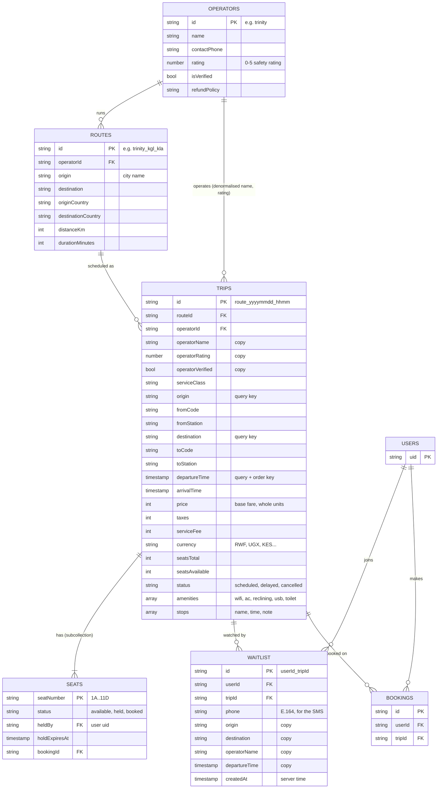

# Search: ERD and database architecture

Owner: Search (Home search, Results, Filters, Waitlist, Trip details).
Database: Cloud Firestore (project `bookme-a73fd`).

## 1. Entity relationship diagram



`USERS`, `BOOKINGS` and the seat-hold fields belong to Auth, Booking & Payment
and Tickets. They are shown only where Search's collections link to them.

## 2. Collections Search owns

| Collection | Written by | Read by | Purpose |
|---|---|---|---|
| `operators/{id}` | Seed script (Admin SDK) | Search, Trust Center | Bus companies and their safety ratings |
| `routes/{id}` | Seed script | Reference / reporting | One operator's corridor between two cities |
| `trips/{id}` | Seed script | Search, Booking, Tickets, Escrow | One scheduled departure |
| `trips/{id}/seats/{n}` | Seed creates; Booking updates | Booking | One document per seat, for safe holds |
| `waitlist/{userId_tripId}` | The traveller (app) | The traveller | "Notify me if a seat opens" |

## 3. Design decisions

**Denormalised trips.** Firestore has no joins. The results list shows the
operator's name, rating and verified badge plus city codes and stations, so
these are copied onto each trip. One query then renders the whole list. The
trade-off: if an operator's rating changes, the seed or an admin job must
re-copy it. That's acceptable because ratings change rarely and trips are
regenerated often.

**Shared field names.** Trips use the names from `lib/data/models/trip.dart`
(`origin`, `destination`, `departureTime`, `price`, ...) and add `fromCode`,
`fromStation`, `toCode`, `toStation`, `taxes` and `serviceFee`. Tickets'
`TripDocumentMapper` reads the same documents with no changes. A test checks
this (`test/features/search/data/bus_trip_model_test.dart`).

**Money is whole numbers in the trip's currency.** RWF has no minor unit, so
doubles are never used. The traveller sees one total: `price + taxes +
serviceFee`.

**Predictable ids.** Trip ids are `route_yyyymmdd_hhmm` and waitlist ids are
`userId_tripId`. Re-running the seed overwrites instead of duplicating, and a
double tap on "Notify me" can't create two waitlist entries. The rules check
the waitlist id format.

**Seats as a subcollection.** Each seat is its own document, so Booking can
hold a seat in a transaction without two travellers getting the same seat.
`seatsAvailable` on the trip is a display figure set by the seed. Client
rules don't allow the app to change it, so it can drift after bookings until
a server function keeps it in sync (see Limitations).

## 4. Queries and composite indexes

All indexes are in `firestore.indexes.json` and deploy with
`firebase deploy --only firestore:indexes`.

| Screen | Query | Index |
|---|---|---|
| Results (5-day strip) | `trips` where `origin ==`, `destination ==`, `departureTime >= start`, `departureTime < start + 5 days`, order by `departureTime` | `origin ASC, destination ASC, departureTime ASC` |
| Results (waitlist badges) | `waitlist` where `userId == uid`, order by `createdAt DESC` (live) | `userId ASC, createdAt DESC` |
| Trip details | `trips/{id}` get (live seat count) | none (single document) |
| Home caption | `operators` order by `name` | none (single field) |
| Booking seat hold (Booking's) | `seats` where `status == 'held'`, `holdExpiresAt <` now | `status ASC, holdExpiresAt ASC` |

**Cost of a search.** One query loads every trip on the route for the five
days of the date strip. Changing the day inside the strip, or any filter
(time, price, operator, amenities), runs on the device and costs no reads.
Filtering stays on the client because Firestore allows range filters on only
a few fields per query, and the filter combinations here would need many
indexes. The filter logic is a pure function, `TripFilter.apply`, unit-tested
in `test/features/search/domain/trip_filter_test.dart`.

## 5. Security rules (Search's part of `firestore.rules`)

- `operators`, `trips`: any signed-in user can read; nobody can write from
  the app. Seed data goes in through the Admin SDK.
- `trips/{id}/seats`: owned by Booking (holds can be taken or released only
  by their holder).
- `waitlist`:
  - read and delete: own entries only (`userId == auth.uid`);
  - create: own entries only. The id must be `uid_tripId`, the trip must
    exist, only the listed fields are allowed, the phone must be E.164 for
    an East African number, and `createdAt` must be the server time;
  - update: never. To change the number, leave and join again.

## 6. Seeding

```bash
dart run tool/export_search_seed.dart      # writes tool/seed/search_seed.json
cd tool/seed && npm install firebase-admin
GOOGLE_APPLICATION_CREDENTIALS=/path/to/service-account.json node seed_search.js
```

The seed has 5 verified operators, 11 routes and 12 daily departures for 10
days from today (120 trips, each with 44 seat documents, about 5,400 writes).
The Volcano Express 07:00 Kigali → Kampala is always fully booked, so the
waitlist can be demonstrated. Keep the service-account key out of the repo;
`.gitignore` excludes `*service-account*.json`.

The app also runs on the same seed data with no Firebase, through
`InMemorySearchRepository.seeded`, which the tests use.

## 7. Limitations and next steps

- **`seatsAvailable` can drift.** Booking marks seats `held` or `booked` in
  the `seats` subcollection, but the app may not update the trip document. A
  Cloud Function on `trips/{id}/seats/{n}` writes should keep `seatsAvailable`
  in step. The same trigger would send the waitlist SMS when a seat returns
  to `available`.
- **SMS sending is not built.** The waitlist stores the number and the trip;
  delivery needs that server function and an SMS provider.
- **Return trips** are captured on the search form but searched one way at a
  time. Book the return by swapping From and To.
